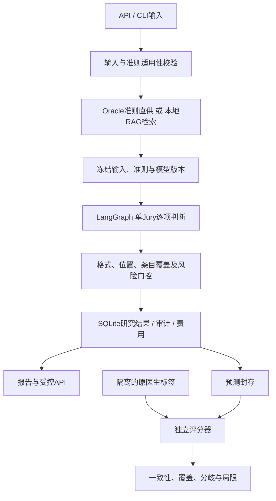

# 系统架构

## 三条逻辑链路

第二条为默认关闭的离线影子链路：调用方提供冻结输入和候选JSON → 逐项契约检查 → 独立SQLite旁表；主结果对象保持原样。第三条是独立meta-evaluation，不是让模型读取正确标签后自评。

## 模块对应

| 模块 | 代码 | 状态 / 限制 |
|---|---|---|
| 输入、准则、输出模型 | `src/medical_jury/domain.py` | 已实现严格字段与病例绑定 |
| 工作流 | `workflow.py` | LangGraph StateGraph，非自主循环；未配置持久化checkpoint saver |
| 模型调用 | `provider.py` | DeepSeek受限HTTPS入口、显式模型/价格、默认一次尝试 |
| 准则检索 | `knowledge.py` | 本地FastEmbed BGE small en v1.5 + Chroma余弦检索；SQLite保留完整记录 |
| 引用与任务线索 | `evidence*.py`、`task_spec*.py` | 可定位不等于语义支持；TaskSpec包含实验分支 |
| 窄范围来源 | `fact_sources.py` | 少量规则/来源卡，不是全面临床指南库 |
| 费用与审计 | `budget.py`、`store.py` | SQLite事务预留、失败保守计费、追加审计 |
| 外部评测 | `benchmark.py`、`experiments/physician-blind-v1-r2/` | 给定准则的医生一致性研究，不证明临床安全 |

## Prompt、记忆、RAG分别是什么

- Prompt：系统角色/权限、任务与单条准则、固定病例、输出契约及不确定性约束；版本化而非运行时随意改写。
- 运行记忆：SQLite任务、快照、费用与审计。不会自动把历史结果变成下一次的正确经验，也没有训练模型权重。
- 示例记忆：候选Prompt只有3个非医疗合成示例，供结构研究，非医生批准的临床示例库。
- RAG：准则向量库；当前病例绑定记录可检索，但跨病例适用性和医学事实核验仍待独立验证。必检项不能被top-k淘汰。

## 原协议与候选协议

当前运行协议主要为二元met/not_met，复核状态另存。第14轮候选使用独立 `prompt-evidence-research-v1`，支持unable_to_determine，但**未接旧API/旧影子入口**。不静默把未定映射成失败/通过；本轮真实测试中候选被截断，未推广。

未接MCP、DeepEval、DSPy/TextGrad或多Agent；本地运行代码不等于本地部署了大模型。未来如拆Retriever/Verifier，也必须先证明收益，不扩大患者数据、网络或工具权限。
